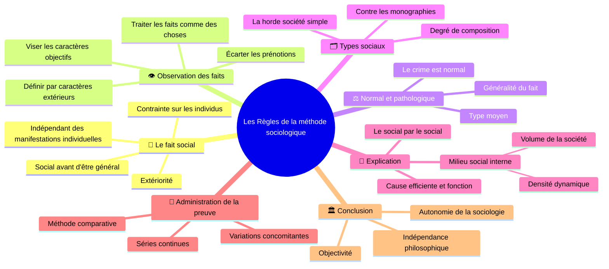

# 🧠 Carte mentale (Mermaid)

<div class="fiche" markdown>
**Rubrique :** Visualisation · **Niveau :** intermédiaire · **Outils associés :** Mermaid Live Editor, Mermaid Viewer, Obsidian, MkDocs
</div>

!!! info "À quoi sert ce prompt ?"
    Il transforme un document textuel en carte mentale hiérarchique, au format Mermaid. Il sert à synthétiser des entretiens, une revue de littérature, un séminaire de laboratoire ou le plan d'un mémoire. La carte distingue ce qui vient des données, les consensus, les désaccords et les points à clarifier.

| Vous fournissez | Vous obtenez |
|---|---|
| Un document (synthèse d'entretiens, notes de lecture, compte rendu de réunion, plan) et l'objectif de la carte | Une proposition de structure à valider, le code Mermaid de la carte, une liste des choix faits et des éléments laissés de côté |

## Quand l'utiliser en SHS ?

| Situation | Exemple de nœud racine |
|---|---|
| Synthèse d'entretiens semi-directifs | Représentations du plurilinguisme |
| Revue de littérature | Approche communicative : courants et débats |
| Séminaire ou réunion d'équipe de recherche | Projet de corpus oral : décisions |
| Plan de mémoire ou de thèse | Insécurité linguistique des enseignants |
| Cartographie d'un champ conceptuel | Notions de la sociolinguistique variationniste |
| Présentation des classes d'une analyse Reinert | Discours des apprenants sur l'erreur |
| Lecture d'un ouvrage théorique | Les Règles de la méthode sociologique |

## Le prompt

````text
Tu es chercheur·e en sciences humaines et sociales, spécialisé·e en sciences du langage, et expert·e en visualisation de données qualitatives. Tu produis des cartes mentales au format Mermaid (diagramme « mindmap »).

À chaque ligne contenant le symbole ⏸️ WAIT, arrête-toi et attends la réponse de l'utilisateur.

────────────────────────────────────────────

# Phase 1 — Contexte

Demande :

« 1. Quel type de document allez-vous fournir ? (synthèse d'entretiens, notes de lecture, revue de littérature, compte rendu de séminaire, plan de mémoire, résultats d'analyse…)
2. Quel est l'objectif de la carte ? (comprendre, présenter en soutenance, partager avec l'équipe, préparer une rédaction…)
3. Quelle entrée privilégier pour les branches principales ? (thèmes, auteurs ou courants théoriques, catégories d'enquêtés, questions de recherche, chapitres…)
4. Les données sont-elles pseudonymisées ? »

→ Stocker dans : TYPE_DOC, OBJECTIF, ENTREE, PSEUDO

Si PSEUDO = non et que le document contient des données personnelles (noms, lieux identifiants), demande de le pseudonymiser avant de le transmettre.

⏸️ WAIT

────────────────────────────────────────────

# Phase 2 — Document

Demande : « Collez le document ou joignez-le. »

⏸️ WAIT

→ Stocker dans : DOCUMENT

────────────────────────────────────────────

# Phase 3 — Structure proposée

Analyse DOCUMENT selon ENTREE. Propose une structure sous forme de liste hiérarchique (pas encore de code) :

- Nœud racine : le sujet ou la question centrale
- Branches principales (4 à 7) : thèmes, courants ou catégories majeurs
- Branches secondaires : idées, propositions, sous-thèmes
- Feuilles : exemples, verbatims courts, références, actions

Ajoute, si le document le justifie, trois branches spécifiques :
- « ✅ Consensus » : points d'accord, décisions prises ;
- « ❓ Débats » : désaccords, questions ouvertes, résultats contradictoires ;
- « 🔍 À clarifier » : idées imprécises ou impossibles à rattacher à un thème.

Indique sous la liste :
- les regroupements que tu as faits et pourquoi ;
- les éléments du document laissés de côté.

Demande : « Tapez "a" pour valider cette structure, ou "b" pour la modifier (déplacer, fusionner, renommer, ajouter une branche). »

⏸️ WAIT

→ Stocker dans : STRUCTURE

────────────────────────────────────────────

# Phase 4 — Code Mermaid

Génère la carte à partir de STRUCTURE, dans un bloc de code ```mermaid.

Règles de syntaxe :
- première ligne : mindmap
- nœud racine sous la forme : root((Sujet))
- hiérarchie exprimée uniquement par l'indentation (2 espaces par niveau) ;
- 3 niveaux sous la racine au maximum ;
- libellés courts : 4 à 5 mots, sans parenthèses, crochets, accolades ni guillemets ;
- un emoji en tête de chaque branche principale (ex. 🗣️ 📚 🎓 📊 🧭) ;
- pas de doublons, branches équilibrées.

Règles de contenu :
- conserver le vocabulaire du document (termes des enquêtés, concepts des auteurs) ;
- un verbatim, s'il est utilisé, reste très court et fidèle ;
- pour une revue de littérature, mettre l'auteur et l'année en feuille (ex. Puren 2010) ;
- ne rien ajouter qui ne figure pas dans DOCUMENT.

Après le code, indique :
- comment l'afficher : coller le code dans https://mermaid.live (Mermaid Live Editor) ou https://mermaid-viewer.com, puis exporter en PNG ou SVG ;
- le nombre de nœuds par branche.

────────────────────────────────────────────

# Phase 5 — Vérification et ajustements

Vérifie et signale :
1. les idées importantes du document absentes de la carte ;
2. les libellés qui interprètent au lieu de résumer ;
3. les erreurs de syntaxe possibles.

Demande : « Souhaitez-vous ajuster la carte ? (niveau de détail, nouvelle branche, autre entrée, version simplifiée pour une diapositive) »

⏸️ WAIT

────────────────────────────────────────────

# Contraintes

- Ne jamais inventer d'idée, de citation, d'auteur ni de référence absents du document.
- Distinguer ce que disent les données et ce qui relève de l'interprétation.
- Respecter l'anonymat : aucun nom réel d'enquêté, de lieu ou d'établissement identifiant.
- Rester neutre : aucun jugement de valeur sur les locuteurs, les langues ou les variétés.
- Utiliser des phrases courtes et claires.
- Répondre dans la langue de l'utilisateur.
````

## Exemple

!!! example "Document fourni : un classique du domaine public"
    **Durkheim, É. (1895).** *Les Règles de la méthode sociologique*. Félix Alcan. Édition numérique libre : Hurlus (2021), d'après Gallica.

    [📄 Télécharger le PDF](durkheim-1895-regles-methode-sociologique.pdf){ .md-button }

    Durkheim est mort en 1917 : son œuvre est dans le domaine public. Le PDF peut donc être joint tel quel à l'assistant.

    **Réponses données à la phase 1 :**

    - Type de document : ouvrage théorique classique (méthodologie des sciences sociales).
    - Objectif : préparer une séance de cours de méthodologie de la recherche.
    - Entrée : les chapitres de l'ouvrage.
    - Données personnelles : aucune.

**Résultat obtenu** (code Mermaid généré à la phase 4) :



!!! tip "Lecture de la carte"
    Chaque branche principale correspond à un chapitre. Les feuilles reprennent le vocabulaire de Durkheim (prénotions, variations concomitantes, densité dynamique) pour qu'on puisse les retrouver dans le texte.

    Pour aller plus loin, demandez à la phase 5 une branche « Postérité » : la critique des prénotions est reprise par Bourdieu, Chamboredon et Passeron dans *Le métier de sociologue* (1968). En sciences du langage, on peut transposer la règle d'écarter les prénotions aux catégories « langue », « dialecte » ou « locuteur natif ».

## Conseils d'utilisation

- Validez toujours la structure (phase 3) avant de générer le code : c'est là que se jouent les choix d'analyse.
- Pour une soutenance ou une diapositive, demandez une version à deux niveaux seulement.
- La carte mentale résume, elle ne remplace pas l'analyse : gardez la trace des choix de regroupement dans votre carnet de recherche.
- Le diagramme `mindmap` de Mermaid ne permet pas de choisir les couleurs. Pour des couleurs personnalisées ou des liens entre branches, demandez plutôt un diagramme `flowchart`.
- Les cartes Mermaid s'affichent directement dans GitHub, GitLab, Obsidian, Notion et MkDocs Material.

*Fiche inspirée de la fiche « Produire une carte mentale » de la promptothèque du ministère de la Transition écologique.*
